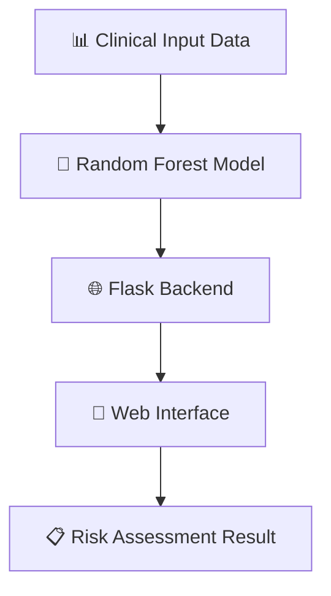

<div align="center">

# ❤️ Heart Failure Risk Prediction System

### _Intelligent Healthcare Through Machine Learning_

[](https://python.org)
[](https://flask.palletsprojects.com)
[](https://scikit-learn.org)
[](https://opensource.org/licenses/MIT)

---

_Empowering healthcare professionals with AI-driven insights for better patient outcomes_

🚀 [Live Demo](https://heart-failure-risk-prediction-v0jn.onrender.com)

</div>

---

## 🌟 About

> **Transform clinical data into actionable insights**

This Heart Failure Risk Prediction System uses a **Random Forest machine learning model** trained on real clinical records to predict the likelihood of patient death due to heart failure. Built with Flask for the backend and a clean, responsive frontend — it delivers real-time risk assessments through an intuitive web interface.

<div align="center">

### 🎯 Key Highlights

| 🔬 **ML Model** | 🌐 **Web Interface** |  📈 **Real-Time**   | 📊 **Dataset** |
| :-------------: | :------------------: | :-----------------: | :------------: |
|  Random Forest  |    Flask Web App     | Instant Predictions |  299 Patients  |

</div>

---

## 🏗️ Architecture



<details>
<summary>📁 <strong>Project Structure</strong></summary>

```
heart-failure-risk-prediction/
┣━━ 🎯 app.py                          # Core Flask application
┣━━ 🧠 heart_failure_model.pkl         # Trained Random Forest model
┣━━ 📊 heart_failure_dataset.csv       # Training dataset (UCI)
┣━━ 📋 requirements.txt                # Python dependencies
┣━━ ⚙️  Procfile                        # Render deployment config
┣━━ 🔒 .gitignore
┣━━ 📂 templates/
┃   ┗━━ 🏠 index.html                 # Prediction form & results UI
┗━━ 📓 Heart_Failure_Risk.ipynb        # EDA & model training notebook
```

</details>

---

## 🚀 Quick Start

<div align="center">

### Get up and running in 60 seconds ⏱️

</div>

```bash
# 📥 Clone the repository
git clone https://github.com/Adinath-Jagtap/heart-failure-risk-prediction.git
cd heart-failure-risk-prediction

# 🏠 Create virtual environment
python -m venv venv
venv\Scripts\activate        # Windows
# source venv/bin/activate   # macOS / Linux

# 📦 Install dependencies
pip install -r requirements.txt

# 🚀 Launch application
python app.py
```

<div align="center">

🌐 **Open your browser** → `http://127.0.0.1:5000`

🎉 **Start predicting!**

</div>

---

## ✨ Features

<div align="center">

<table>
<tr>
<td align="center" width="33%">

### 🎨 Intuitive Design

Clean, modern interface with real-time form validation and helpful medical tooltips

</td>
<td align="center" width="33%">

### ⚡ Lightning Fast

Instant predictions powered by a pre-trained Random Forest model — no waiting

</td>
<td align="center" width="33%">

### 🔬 Scientifically Grounded

Trained on a real peer-reviewed clinical dataset with 12 validated biomarkers

</td>
</tr>
</table>

</div>

### 🔍 What Makes This Special

- **🎯 12 Clinical Parameters** — Age, ejection fraction, serum creatinine, sodium, platelets, and more
- **📊 Real Patient Data** — Built on 299 validated clinical records from a published research study
- **🔄 Confidence Scores** — Every prediction includes a percentage confidence level
- **📱 Fully Responsive** — Works on desktop, tablet, and mobile
- **⚕️ Clear Disclaimer** — Medical context and responsible use guidance built into the UI

---

## 📊 Model Performance

<div align="center">

|      Metric       |          Value           |
| :---------------: | :----------------------: |
|   **Algorithm**   | Random Forest Classifier |
| **Training Set**  |   299 patient records    |
| **Test Accuracy** |         **85%**          |
|    **Library**    |       scikit-learn       |

_Model was trained and validated in `Heart_Failure_Risk.ipynb`_

</div>

---

## 🧠 Clinical Features Used

| Feature                  | Description                                   | Type    |
| ------------------------ | --------------------------------------------- | ------- |
| Age                      | Patient age in years                          | Numeric |
| Sex                      | Biological sex                                | Binary  |
| Anaemia                  | Reduction in red blood cells                  | Binary  |
| Diabetes                 | Presence of diabetes                          | Binary  |
| High Blood Pressure      | Hypertension status                           | Binary  |
| Smoking                  | Smoking status                                | Binary  |
| Ejection Fraction        | % of blood pumped per heartbeat               | Numeric |
| Creatinine Phosphokinase | Enzyme level indicating muscle damage (mcg/L) | Numeric |
| Platelets                | Blood clotting factor (kiloplatelets/mL)      | Numeric |
| Serum Creatinine         | Kidney function indicator (mg/dL)             | Numeric |
| Serum Sodium             | Electrolyte balance (mEq/L)                   | Numeric |
| Follow-up Period         | Days patient was monitored                    | Numeric |

---

## 🧪 Research & Development

<div align="center">

### 📚 Comprehensive Analysis in the Notebook

</div>

`Heart_Failure_Risk.ipynb` contains:

- 🔍 **Exploratory Data Analysis** — Patient demographics and clinical pattern insights
- 📈 **Data Visualization** — Age distributions, survival correlations, feature importance plots
- 🎯 **Model Training** — Random Forest training with accuracy evaluation
- 📊 **Confusion Matrix** — Full classification report and performance breakdown

---

## 📦 Dataset & Credits

**Dataset:** Heart Failure Clinical Records Dataset

- **Source:** [UCI Machine Learning Repository](https://archive.ics.uci.edu/dataset/519/heart+failure+clinical+records)
- **Kaggle Mirror:** [Heart Failure Prediction](https://www.kaggle.com/datasets/andrewmvd/heart-failure-clinical-data)
- **License:** CC BY 4.0

**Original Research:**

> Chicco, D., & Jurman, G. (2020). _Machine learning can predict survival of patients with heart failure from serum creatinine and ejection fraction alone._ BMC Medical Informatics and Decision Making, 20, 16.
> [https://doi.org/10.1186/s12911-020-1023-5](https://doi.org/10.1186/s12911-020-1023-5)

---

## 🤝 Contributing

We welcome contributions! Here's how:

```bash
# 🍴 Fork & create a branch
git checkout -b feature/your-improvement

# 💻 Make your changes and commit
git commit -m "Add: your improvement description"

# 📤 Push and open a Pull Request
git push origin feature/your-improvement
```

<div align="center">

| 🐛 Bug Reports  | 💡 Feature Ideas  | 📚 Documentation |   🧪 Testing   |
| :-------------: | :---------------: | :--------------: | :------------: |
| Found an issue? | Have a cool idea? | Improve the docs | Add test cases |

</div>

---

<div align="center">

### ⚕️ Medical Disclaimer

_This tool is for **educational and research purposes only**. It does not replace professional medical advice, diagnosis, or treatment. Always consult a qualified healthcare provider for clinical decisions._

---

</div>
